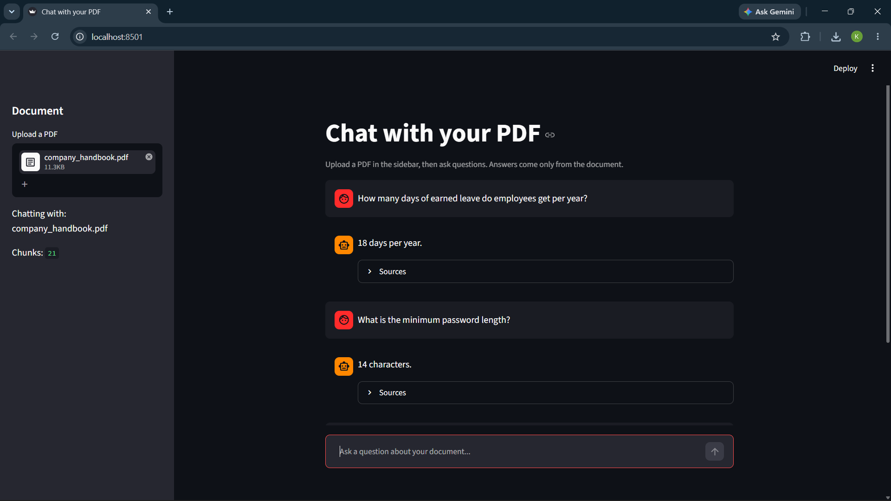

# RAG PDF Chatbot

Chat with any PDF. Upload a document, ask questions, and get answers based only on its text, with the source pages shown.

## Features
- Upload any text-based PDF
- Semantic search using sentence embeddings and a FAISS vector index
- Answers written by Google Gemini using only the retrieved context
- Replies "I couldn't find that in the document" when the answer is not there
- Source pages and text shown under every answer

## How it works
PDF -> text chunks (500 characters, 100 overlap) -> embeddings (all-MiniLM-L6-v2) -> FAISS index -> top 4 matching chunks -> prompt to Gemini -> answer with sources

## Tech stack
Python, Streamlit, sentence-transformers, FAISS, pypdf, Google Gemini API

## Run locally
1. Clone the repo and open the folder
2. Create and activate a virtual environment:
   python -m venv venv
   venv\Scripts\activate
3. Install packages:
   pip install -r requirements.txt
4. Create a file named .env containing:
   GEMINI_API_KEY=your_key_here
5. Start the app:
   streamlit run app.py --server.fileWatcherType none

## Screenshot
